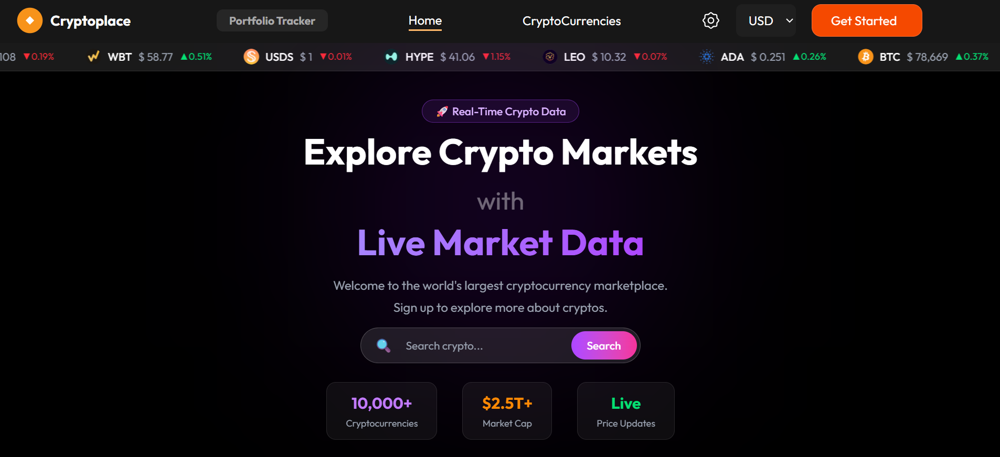

# CryptoPlace — Cryptocurrency Dashboard

CryptoPlace is a full-stack cryptocurrency dashboard built with **React.js, Tailwind CSS, Node.js, and Express.js**. It enables users to explore cryptocurrency market data, analyze historical price trends, manage favorite coins, and track market movements through a responsive interface.

🔗 **Live Demo:** [my-crypto-place.vercel.app](https://my-crypto-place.vercel.app/)

## Screenshots

### Desktop UI

### Mobile UI

## Features

- **Live Market Data:** View cryptocurrency prices, market capitalization, trading volume, and price changes.
- **Search & Explore:** Search and browse cryptocurrencies by market data.
- **Coin Details:** View detailed cryptocurrency information through dynamic routing.
- **Historical Price Charts:** Visualize cryptocurrency price trends over selected periods.
- **Multi-Currency Support:** Switch between USD, INR, and EUR.
- **User Authentication:** Register and log in with cookie-based authentication.
- **Favorites System:** Add and remove favorite coins with user-specific data persistence.
- **Portfolio Tracker:** Access the portfolio tracker interface for cryptocurrency holdings.
- **Dark & Light Themes:** Switch between themes for a personalized viewing experience.
- **Responsive Design:** Optimized layouts for desktop and mobile devices.
- **Market Overview:** Explore global cryptocurrency market statistics.

## Performance & Backend Engineering

- **Service Layer:** Separated CoinGecko API communication from Express route handlers.
- **TTL-Based Caching:** Cache market data to reduce repeated external API requests.
- **In-Flight Request Deduplication:** Reuse pending requests for identical cache keys to prevent redundant upstream calls during concurrent requests.
- **API Rate Limiting:** Protect backend endpoints against excessive client requests.
- **Graceful Error Handling:** Handle external API failures and rate limits with appropriate error responses and cached-data fallbacks where implemented.
- **Redis & Docker:** Use Redis for shared caching across backend instances, with Docker for local Redis development.

## Tech Stack

### Frontend
- React.js
- React Router DOM
- Tailwind CSS
- TanStack Query
- Context API
- React Google Charts

### Backend
- Node.js
- Express.js
- MongoDB & Mongoose
- Axios
- JWT Authentication
- HTTP-only Cookies
- bcrypt

### Caching & Deployment
- Redis
- Docker
- Vercel
- Render

### External API
- CoinGecko API

## Application Pages

- Home / Market Overview
- Cryptocurrency Listing
- Coin Details
- Favorites
- Portfolio Tracker
- About Us
- Features
- Help Center
- Authentication

## What I Learned

Through CryptoPlace, I gained practical experience in full-stack development, REST API integration, authentication, database-backed user features, dynamic routing, global state management, chart visualization, and responsive UI development.

I also explored backend performance engineering through TTL caching, in-flight request deduplication, API rate limiting, and Redis-based caching architecture.

## Future Improvements

- Expand portfolio tracking with transaction history and profit/loss calculations.
- Introduce automated load testing and performance benchmarks.
- Improve cache monitoring and observability.
- Add further reliability improvements for external API failures.

---

Built as a hands-on project to explore full-stack development and backend performance optimization.
